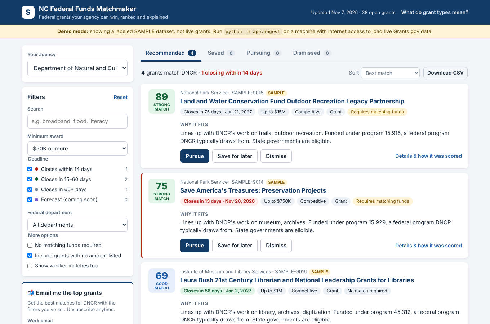

# NC Federal Funds Matchmaker

A simple website for North Carolina state agencies. Pick your agency and you get the open federal grants you're **eligible for**, **ranked by fit**, each with a **plain-English reason**. Mark each one **Pursue**, **Save for later** or **Dismiss**. You can also get the top matches **by email** daily, weekly, every two weeks or monthly.

It covers 30 NC agencies: cabinet departments, Council of State offices, commissions, the UNC System and the Community College System.

Recommendations default to scores of **50 and above**. Use **Minimum score** above the results to change the cutoff,
or toggle **Include lower scores** to see all scores while keeping your chosen cutoff. The page shows how many lower-scoring
grants are hidden. Your preferences are remembered in this browser; **Reset** restores 50+. Saved, Pursuing and Dismissed grants
remain visible regardless of score. CSV exports and new email subscriptions use the selected score settings.



*NCDOT results showing the minimum-score filter, relevance breakdown, AI previews, and email alerts. Captured November 7, 2026.*

```
Grants.gov ─┐                       ┌─ Guardrails ─┐   ┌─ Blended score ─┐   ┌─ Website (React) ─┐
SAM.gov ────┼─ daily ingest ─ normalize │ expired ✗    ├──▶│ 45 mission/proj │──▶│ filters, triage   │
USAspending ┘                       │ < $50K ✗     │   │ 25 program fit  │   │ CSV export        │
                                    │ ineligible ✗ │   │ 15 eligibility  │   └─ Email digests ───┘
                                    └──────────────┘   │ 10 timing, 5 $  │
                                                       │ ± team feedback │
                                                       └─────────────────┘
```

## Run it

There are two ways to run it. Both serve the site at http://localhost:8000, so only one can run at a time.

| | What runs | Database | Use it for |
|---|---|---|---|
| **A. Docker Compose** (recommended) | 3 containers: `db`, `api`, `web` | PostgreSQL | Running the app, deploying |
| **B. No Docker** | `uvicorn` on your machine | SQLite file | Developing and running tests |

The database is chosen by `DATABASE_URL`: set it to a `postgresql://` URL for PostgreSQL, leave it empty for SQLite. Compose sets it for you.

On first start the database is empty, so it loads a clearly labeled **SAMPLE dataset** (yellow "Demo mode" banner, "SAMPLE" tag on each card). Load live data with the ingest command shown for each option. `--max 100` is a quick check with the first 100 records; drop it to load everything (a few minutes), and live data replaces the sample set. After that the server re-ingests every day at 6:07 server time.

### A. Docker Compose (three services)

You need Docker. Copy `.env.example` to `.env` (optional; everything has a default).

```bash
./redeploy.sh                                                 # build and start db, api, web; waits until the site is up
docker compose exec api python -m app.ingest --max 100        # load live data
```

`./redeploy.sh` is `docker compose up -d --build` plus a wait for the site (and it removes the container from the old single-container setup if it's still around). `./redeploy.sh --env` restarts only the api after you edit `.env`.

Open http://localhost:8000.

| Service | Image | What it does |
|---|---|---|
| `db` | `postgres:17-alpine` | Stores everything in the `pgdata` volume. Not exposed outside Docker. |
| `api` | `server/Dockerfile` | FastAPI, the daily ingest scheduler and email digests. Reads `.env`. Not exposed outside Docker. |
| `web` | `web/Dockerfile` | nginx serving the built React site, forwarding `/api/*` to `api`. Published on port 8000. |

Everyday commands:

```bash
docker compose up --build -d     # rebuild after code changes (only changed services restart)
./redeploy.sh --env             # pick up .env changes (no rebuild)
docker compose logs -f api       # follow the API logs
docker compose ps                # what's running
docker compose down              # stop (data is kept)
docker compose down -v           # stop and delete the database (starts over with SAMPLE data)
docker compose exec db psql -U matchmaker matchmaker   # SQL shell
```

Set `WEB_PORT=8080` (in your shell or `.env`) to publish on a different port, and `POSTGRES_PASSWORD` to change the database password before the first start.

### B. No Docker

You need Python 3.11+ and Node 18+. Run each line from the repo root.

```bash
cd server && pip install -r requirements.txt
cd web && npm install && npm run build
cd server && uvicorn app.main:app --port 8000
cd server && python -m app.ingest --max 100        # load live data
```

**Developing the UI:** run the API with `uvicorn app.main:app --reload --port 8000`, then `cd web && npm run dev` and open http://localhost:5173 (calls to `/api` are proxied).

**Tests:** `cd server && python -m pytest -q` (79 tests: guardrails, ranking, triage, email, export, research, feedback). They use a temporary SQLite database.

## How it meets the blueprint

| Blueprint item | Where | What it does |
|---|---|---|
| Temporal filtering | `server/app/guardrails.py`, `normalize.py` | Drops anything past its close date, re-checked on every search. Categories: **Urgent** (≤14 days), **Standard** (15–60), **60+ days**, **Forecast** |
| $50K financial floor | `guardrails.py` | Uses the award ceiling, otherwise the average award (total ÷ number of awards). Users can raise the floor but not lower it. Grants with no listed amount are kept and flagged, and a checkbox hides them |
| Strict eligibility | `agencies.py`, `guardrails.py` | Grants.gov applicant codes: state agencies need 00 (State governments) or 99 (Unrestricted); the UNC System and community colleges need 06. Code 25 ("Others") is kept at lower weight. Checked **before** scoring |
| Multi-source | `ingest/` | Grants.gov `search2` + `fetchOpportunity` (posted and forecasted) · SAM.gov Assistance Listings (program objectives, optional key) · USAspending (how much NC received under each program last fiscal year) |
| Strategic plans | "Improve your matches" panel → `agency_documents` | Paste or upload plan text. It's split into chunks and embedded, and the best-matching chunk counts toward mission fit |
| Project intake | same panel → `projects` | Staff log active projects. A grant that fits a project gets a boost and names the project in its explanation |
| Blended score | `matching/score.py` | 45 mission + project similarity · 25 program fit (an Assistance Listing the agency usually receives + keywords) · 15 eligibility · 10 timing · 5 award size · ± feedback. Every part is shown under "Details & how it was scored" |
| Explanations | `matching/explain.py` | Rule-based by default (instant, free). With Azure OpenAI configured, the first 5 results per page get AI previews grounded in the listing, agency/project/plan context and score breakdown. Cached by the prompt, context, score and deployment |
| Pursue / Save / Dismiss | `GrantCard.jsx`, `POST /api/decisions` | Pursue can email the opportunity and a note to the grant-writing team. Dismiss asks for a reason (e.g. "Can't meet the match"), and those reasons adjust future scores for that agency |
| Human decides | throughout | Nothing is auto-applied. Scores are labeled as recommendations |
| precision@10 | `app/evaluate.py`, `GET /api/metrics` | Computed from real Pursue/Save/Dismiss labels |
| Export | "Download CSV" | Current view with scores and reasons |
| Email alerts | `emailer.py` | Public double opt-in signup for any email domain, daily/weekly/biweekly/monthly, a custom count of 1–100 grants, saved filters, rate limits and token-based unsubscribe without sign-in |

The card preview separates mission/program relevance (70 possible points) from eligibility, timing and award size (30).
The additive score and ranking stay the same. A **Good match** label needs a total of at least 50, at least 18/45 semantic points,
and 35/70 relevance points. **Strong match** needs 70 total, 27/45 semantic and 49/70 relevance points. Otherwise the label is
**Possible match**, including high totals driven by practical factors or feedback. These screening thresholds still need validation
with agency reviewers; text similarity can overstate substantive relevance.

AI previews receive the score, component points, matching mission/plan excerpt, project details and listing facts. They use scoring
evidence as background and describe the grant's fit, limitations and next check without repeating score arithmetic. They flag domain
mismatches even when the computed label is optimistic. Empty project lists are treated
as missing context. Explanations are cached by their exact prompt/context/score and chat deployment, so old summaries are
replaced on demand when those inputs change; existing rows do not need to be deleted or migrated.

### Azure (optional; everything works without it)

| Set these | What changes |
|---|---|
| `AZURE_OPENAI_ENDPOINT`, `AZURE_OPENAI_KEY`, `AZURE_EMBEDDING_DEPLOYMENT` | Similarity switches from local TF-IDF to Azure OpenAI embeddings once every opportunity has a vector. Vectors are computed at ingest; for data loaded before you set these, run `cd server && python -m app.ingest --embed`. If Azure fails (wrong deployment name, bad key), matching falls back to TF-IDF and the server log says why. Re-tune `CALIBRATION` in `matching/embeddings.py` for your embedding model |
| `AZURE_CHAT_DEPLOYMENT` | AI-written match previews for the first 5 results per page and in emails |
| `ACS_CONNECTION_STRING` | Real email through the Azure Communication Services email API, using the connection string from the resource's Keys page. No SMTP login or Entra app needed. Set `SMTP_FROM` to the email domain's MailFrom address. ACS Email is being retired September 30, 2028 |
| `SMTP_*` | Real email through SendGrid, Azure Communication Services (being retired September 30, 2028) or any SMTP relay. Microsoft is retiring password sign-in for SMTP in Exchange Online, so check with IT before using an Office 365 mailbox. Without it, emails go to `server/data/outbox/`. Test the settings with `cd server && python -m app.emailer you@agency.nc.gov` |
| `SAM_API_KEY` | SAM.gov program descriptions are added to the matching text |

See `.env.example` for every setting. Copy it to `.env` in the repo root and the server reads it on startup (real environment variables win). Docker Compose passes it to the `api` service.

**Deploy with Docker Compose:** on an Azure Linux VM, `docker compose up -d` runs all three services, with PostgreSQL's data in the `pgdata` volume on the VM's disk. Put an HTTPS reverse proxy in front of `web`. Run one `api` container: the scheduler and active research jobs run inside that process. For a managed database, point `DATABASE_URL` at Azure Database for PostgreSQL and drop the `db` service.

For Azure Container Apps or App Service, use Azure Database for PostgreSQL through `DATABASE_URL`. See [Azure deployment notes](docs/azure-deployment.md).

### Test a grant digest

**Public subscriptions:** anyone can sign up at `/subscribe` and confirm their
email, regardless of domain. Public digests exclude internal agency projects,
plans and decisions. See [public signup and API limits](docs/public-subscriptions.md)
for rate limits, confirmation protections and required Azure authentication exclusions.

For production sender-domain verification and SPF/DKIM setup, follow
[the email deliverability guide](docs/email-deliverability.md). DNS verification
requires an approved domain and its DNS administrator.

In the email signup panel, enter your email, select the grant count and filters,
then click **Send me a test email**. It sends a one-time ranked digest without
creating or changing a subscription. Production tests go only to the signed-in
work email. Without SMTP or ACS configured, tests are saved to `server/data/outbox/`
and the UI reports that they were not emailed. Use `.env.example` to configure
your email provider; keep credentials in `.env`, never in source control.

Select **Daily** under **How often** for daily subscriptions. After confirmation,
the first digest is sent immediately; subsequent digests are scheduled for 12:00 UTC
on the next day (7 AM Eastern standard time / 8 AM daylight time). The running
server checks for due subscriptions every 15 minutes. No-match scheduled digests
are skipped; the next send is still scheduled. Test emails include an empty-state
message if no grants match.

### Staff sign-in and agency permissions

Production now requires Azure Container Apps Entra authentication. Staff receive
`Agency.<agency-id>` app roles; administrators receive `Matchmaker.Admin`.
The API checks tenant and agency permissions, and the agency picker only lists
authorized agencies. Local Python development remains anonymous by default.

Follow [the access-control setup guide](docs/access-control.md) before deploying:
it covers app registration, role/group assignments, authentication settings,
environment variables, ingress restrictions and verification. Docker defaults to
production authentication; do not pass development authentication values from a
local `.env` into a production deployment.

## Team lanes: what's done and what's next

- **Lane A, Cloud & Ops.** Done: Docker Compose (PostgreSQL, API, nginx web), env-based config, in-app daily scheduler. Next: create the Azure resource group, Container Registry, Container App, Azure OpenAI deployments and Entra ID auth. For production, point `DATABASE_URL` at Azure Database for PostgreSQL and move the in-memory vector index → Azure AI Search (same inputs/outputs; see `matching/embeddings.py`).
- **Lane B, Data & Ingestion.** Done: Grants.gov, USAspending and SAM.gov connectors, normalization, and 30 agency profiles in `server/app/agencies.py`. Next: **run the live ingest and check the parsed fields** (see the caveats below), have each agency confirm its mission summary and typical programs (Assistance Listing prefixes), and load real strategic plans.
- **Lane C, Matching & AI.** Done: blended scoring, feedback loop, explanation prompt, precision@10. Next: label 20–30 grants for 3–4 agencies, run `python -m app.evaluate`, then tune `WEIGHTS` / `CALIBRATION`.
- **Lane D, App & Story.** Done: the site, triage, CSV, email signup and preview, glossary. Next: the pitch (outline below) and a usability check with a real grants coordinator.

## Honest caveats

- **Live APIs are untested from our build machine.** Its network blocked api.grants.gov and api.usaspending.gov. The Grants.gov parser was written against the documented response shape and reads fields defensively, but run `python -m app.ingest --max 50` first and check the results. The **SAM.gov endpoint is the least certain**; check it with `python -m app.ingest --sam-check 66.460`, and set `SAM_ASSISTANCE_URL` if it differs.
- **The sample dataset is invented** (numbers start with `SAMPLE-`). It's for demos and tests only.
- **Agency mission summaries and program lists were written by the team** from public descriptions. Have each agency correct them.
- **Production login requires Azure setup.** The app enforces tenant and agency roles from Container Apps Easy Auth; configure it using [the access-control guide](docs/access-control.md). Local development remains anonymous.

## 6-minute pitch outline

1. **The problem (45s).** Grant-finding depends on whoever has time. At DNCR, one person checks Grants.gov by hand. Grants.gov isn't complete, eligibility is buried, and agencies miss money.
2. **The idea (30s).** Pick your agency and get only the grants you can win, ranked and explained. Or let them come to your inbox.
3. **Live demo (2.5 min).** Pick DEQ and see the urgent PFAS grant on top with its reason → open "how it was scored" → add an active project and watch the matching grant move up and name it → Pursue, which emails the grant team → Dismiss with "can't meet match" → subscribe to the weekly email and show the email.
4. **Trust (45s).** Four guardrails (expired, under $50K, ineligible, single-source) · transparent score · humans decide · public data only, Entra ID sign-in, double opt-in email (for the IT and cybersecurity judges).
5. **Scale and next steps (1 min).** Already covers 30 agencies. Azure deployment plan · precision@10 from real decisions · the NC past-funding signal from USAspending · ask agencies to load their strategic plans.
